<!-- ========================================================= -->
<!-- RAHUL OS 2.0                                              -->
<!-- AI ENGINEER EDITION                                       -->
<!-- Designed for Rahul Bhadekar                               -->
<!-- Theme: Cinematic Obsidian / Electric Blue / Violet        -->
<!-- ========================================================= -->

<!-- ==================== CINEMATIC HERO ==================== -->

  

  
  
  
  

<!-- ==================== AI INTELLIGENCE CORE ==================== -->

  

<!-- ==================== ENGINEERING TOOLKIT ==================== -->

  

<!-- ==================== NEURAL ARCHITECTURE ==================== -->

  

<!-- ==================== CINEMATIC PROJECT GALLERY ==================== -->

  

  
  
  
  

<!-- ==================== PORTFOLIO EXPERIENCE ==================== -->

  

  

<!-- ==================== DEVELOPER TELEMETRY ==================== -->

  

<!-- ==================== GITHUB STATISTICS ==================== -->

  

  

<!-- ==================== LANGUAGE ANALYTICS ==================== -->

  

<!-- ==================== ACTIVITY GRAPH ==================== -->

  

<!-- ==================== CONTRIBUTION UNIVERSE ==================== -->

  <h3>CONTRIBUTION UNIVERSE</h3>

  Every commit tells a story.

  

<!-- ==================== ANIMATED CONTRIBUTION SNAKE ==================== -->

  

<!-- ==================== PAC-MAN CONTRIBUTION GRAPH ==================== -->

  

<!-- ==================== RAHULTECHNOTES STUDIO ==================== -->

  

  

<!-- ==================== PROFESSIONAL CONTACT ==================== -->

  <h2>Let's build something meaningful.</h2>

  
Connect. Collaborate. Create.

  
  
  
  

<!-- ==================== CINEMATIC SIGNATURE ==================== -->

  

<!-- ========================================================= -->
<!-- END OF RAHUL OS 2.0                                       -->
<!-- AI ENGINEER EDITION                                       -->
<!-- RAHULTECHNOTES | LEARN • CODE • GROW                       -->
<!-- ========================================================= -->
