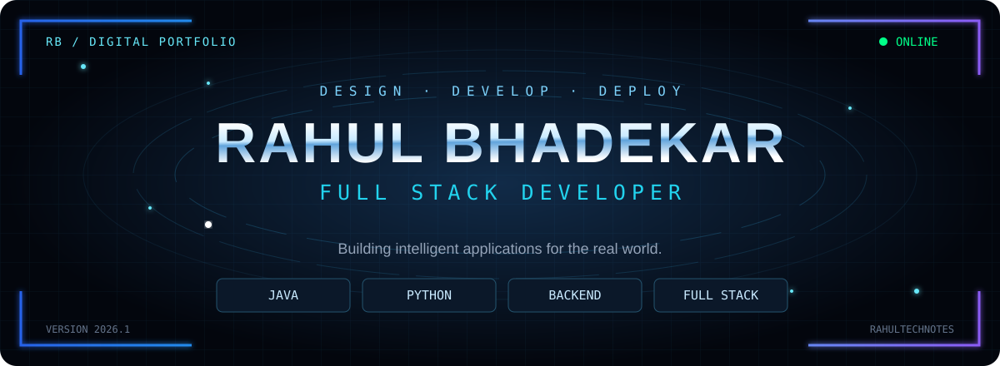
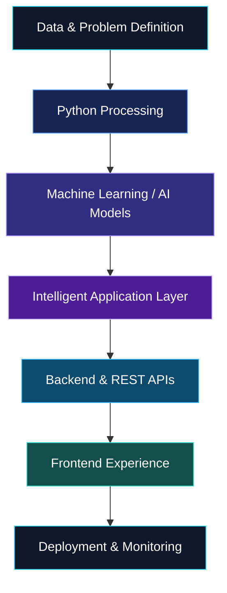

<!-- ====================================================== -->
<!--          RAHUL OS 2.0 — AI Engineer Edition            -->
<!-- ====================================================== -->

  

   

  

    

  
  
  
  

    

  

  

 

<!-- ====================================================== -->
<!--                  DEVELOPER IDENTITY                    -->
<!-- ====================================================== -->

## ◈ 01 // DEVELOPER IDENTITY

  

### AI Engineer | Python & Full Stack Developer

I am a Computer Science Engineering graduate with a strong interest in Artificial Intelligence, Python development, intelligent applications, and scalable full stack systems.

My focus is on building practical software that combines intelligent automation, reliable backend architecture, and meaningful user experiences.

- **Primary Focus:** Python, Artificial Intelligence and Generative AI.
- **Engineering Domains:** Machine Learning, Deep Learning, LLMs and Intelligent Systems.
- **Development:** Django, Java, Spring Boot, React and REST APIs.
- **Databases:** PostgreSQL, MySQL and relational database systems.
- **Knowledge Sharing:** Technical notes, programming concepts and interview preparation through RahulTechNotes.

  

<!-- ====================================================== -->
<!--                   AI UNIVERSE                          -->
<!-- ====================================================== -->

## ◈ 02 // ARTIFICIAL INTELLIGENCE UNIVERSE

  

    

  
  
  
  
  
  

### AI Engineering Focus Areas

| Domain | Focus |
|:---|:---|
| Python Engineering | Automation, application development and data processing |
| Machine Learning | Predictive systems and intelligent decision-making |
| Deep Learning | Neural networks and advanced AI architectures |
| Generative AI | Intelligent content generation and AI applications |
| Large Language Models | Language understanding and AI-powered assistants |
| AI Integration | Connecting intelligent capabilities with real-world applications |
| AI Deployment | Reliable APIs and scalable AI-enabled software |

  

<!-- ====================================================== -->
<!--                  TECHNOLOGY UNIVERSE                   -->
<!-- ====================================================== -->

## ◈ 03 // TECHNOLOGY UNIVERSE

  

### Primary Technology — Python & AI

  

### Backend Development

  

### Frontend Development

  

### Development Tools

  

  

<!-- ====================================================== -->
<!--              AI ENGINEERING ARCHITECTURE               -->
<!-- ====================================================== -->

## ◈ 04 // AI ENGINEERING ARCHITECTURE

  

  

<!-- ====================================================== -->
<!--                   PROJECT MULTIVERSE                   -->
<!-- ====================================================== -->

## ◈ 05 // PROJECT MULTIVERSE

### 01 — HireSmart | AI-Powered Recruitment Platform

  

    

  

  

**Technology:** Python, Django, React, PostgreSQL

An AI-powered recruitment platform connecting candidates and recruiters through intelligent resume analysis, skill-gap identification, job recommendations and candidate matching.

---

### 02 — ClickStore | Full Stack E-Commerce Platform

  

    

  

**Technology:** Java, Spring Boot, PostgreSQL

A full stack e-commerce project featuring product management, backend services, database integration, bulk product imports and automated product image uploads.

---

### 03 — GoTrip | Full Stack Travel Application

  

    

  

A full stack travel application designed to provide a convenient digital travel experience through integrated frontend and backend systems.

---

### 04 — Revitalize | Waste Management System

  

    

  

**Technology:** HTML, CSS, JavaScript

A sustainability-focused web application promoting waste management awareness, recycling and responsible environmental practices.

  

<!-- ====================================================== -->
<!--                  PORTFOLIO EXPERIENCE                  -->
<!-- ====================================================== -->

## ◈ 06 // PORTFOLIO EXPERIENCE

  

    

  

  

<!-- ====================================================== -->
<!--                  DEVELOPER TELEMETRY                   -->
<!-- ====================================================== -->

## ◈ 07 // DEVELOPER TELEMETRY

  

  

    

  

### Contribution Activity

  

  

<!-- ====================================================== -->
<!--                  CONTRIBUTION UNIVERSE                 -->
<!-- ====================================================== -->

## ◈ 08 // CONTRIBUTION UNIVERSE

### 3D Contribution Skyline

  

### Animated Contribution Snake

  <picture>
    <source media="(prefers-color-scheme: dark)" srcset="https://raw.githubusercontent.com/rahulbhadekar/rahulbhadekar/output/github-snake-dark.svg"/>
    <source media="(prefers-color-scheme: light)" srcset="https://raw.githubusercontent.com/rahulbhadekar/rahulbhadekar/output/github-snake.svg"/>
    
  </picture>

### Pac-Man Contribution Animation

  <picture>
    <source media="(prefers-color-scheme: dark)" srcset="https://raw.githubusercontent.com/rahulbhadekar/rahulbhadekar/output/pacman-contribution-graph-dark.svg"/>
    <source media="(prefers-color-scheme: light)" srcset="https://raw.githubusercontent.com/rahulbhadekar/rahulbhadekar/output/pacman-contribution-graph.svg"/>
    
  </picture>

  

<!-- ====================================================== -->
<!--                     KNOWLEDGE HUB                      -->
<!-- ====================================================== -->

## ◈ 09 // KNOWLEDGE HUB

  

### RahulTechNotes — LEARN • CODE • GROW

Sharing programming concepts, technical notes, interview preparation resources and practical development knowledge.

- Python & Artificial Intelligence
- Java & Object-Oriented Programming
- Data Structures & Algorithms
- Full Stack Development
- Backend Development & Databases
- Technical Interview Preparation

  

  

<!-- ====================================================== -->
<!--                    CONNECT WITH ME                     -->
<!-- ====================================================== -->

## ◈ 10 // CONNECT WITH ME

  Open to opportunities in AI Engineering, Python Development, Backend Development and Full Stack Development.

    

  

  

  

  

    

  

<!-- ====================================================== -->
<!--                     END OF README                      -->
<!-- ====================================================== -->
