<!-- ====================================================== -->
<!--          RAHUL OS 2.0 — AI Engineer Edition            -->
<!-- ====================================================== -->

<div align="center">

  

  <h1>Hi there, I'm Rahul Bhadekar 👋</h1>

  <h3>AI Engineer | Python Developer | Full Stack Developer</h3>

  <a href="https://git.io/typing-svg">
    
  </a>

  <br/>

  <a href="https://rahul-bhadekar-portfolio.netlify.app">
    
  </a>
  <a href="https://linkedin.com/in/rahul-bhadekar">
    
  </a>
  <a href="https://github.com/rahulbhadekar">
    
  </a>
  <a href="mailto:rahulbhadekar2@gmail.com">
    
  </a>

  <br/><br/>

  

  

  <br/><br/>

  <a href="#01--about-me">About</a> •
  <a href="#03--artificial-intelligence-universe">AI</a> •
  <a href="#04--technology-universe">Skills</a> •
  <a href="#05--project-multiverse">Projects</a> •
  <a href="#08--developer-telemetry">Analytics</a> •
  <a href="#11--lets-connect">Connect</a>

</div>

---

<!-- ====================================================== -->
<!--                      ABOUT ME                          -->
<!-- ====================================================== -->

## 01 — About Me


I am a Computer Science Engineering graduate with a strong interest in **Artificial Intelligence, Python development and full stack engineering**.

I enjoy building practical software that combines intelligent automation, reliable backend systems and meaningful user experiences.

My engineering interests include:

- Python and Artificial Intelligence
- Generative AI and intelligent applications
- Machine Learning and Deep Learning
- Large Language Models and AI Agents
- Backend development and REST APIs
- Full stack application development
- Relational databases and software architecture

Beyond development, I share technical knowledge, programming concepts and interview preparation resources through **RahulTechNotes**.

<br clear="all"/>

### My Developer Identity

```python
class Developer:
    def __init__(self):
        self.name = "Rahul Bhadekar"
        self.role = "AI & Full Stack Developer"
        self.primary_language = "Python"
        self.secondary_language = "Java"

        self.focus_areas = [
            "Artificial Intelligence",
            "Generative AI",
            "Machine Learning",
            "Intelligent Applications",
            "Full Stack Engineering"
        ]

        self.values = [
            "Continuous Learning",
            "Problem Solving",
            "Clean Code",
            "Knowledge Sharing"
        ]

    def mission(self):
        return "Build technology that creates real impact."
```

---

<!-- ====================================================== -->
<!--                     WHAT I DO                          -->
<!-- ====================================================== -->

## 02 — What I Do

<table width="100%">
  <tr>
    <td width="50%" valign="top">

### 🧠 AI Engineering

- AI-powered application development
- Intelligent automation
- Machine Learning concepts
- Generative AI integration
- LLM-based application exploration

    </td>
    <td width="50%" valign="top">

### 🐍 Python Development

- Python programming
- Django applications
- Backend development
- Data processing
- REST API development

    </td>
  </tr>
  <tr>
    <td width="50%" valign="top">

### ⚙️ Full Stack Engineering

- Java and Spring Boot
- React.js applications
- Authentication systems
- Database integration
- Client-server architecture

    </td>
    <td width="50%" valign="top">

### 📚 Knowledge Sharing

- Programming notes
- Technical documentation
- Interview preparation
- Developer resources
- RahulTechNotes

    </td>
  </tr>
</table>

---

<!-- ====================================================== -->
<!--                     AI UNIVERSE                        -->
<!-- ====================================================== -->

## 03 — Artificial Intelligence Universe

<div align="center">

  

</div>

### AI Engineering Focus Areas

| Domain | Engineering Focus |
|:---|:---|
| 🐍 Python Engineering | Automation, application development and data processing |
| 🧠 Machine Learning | Predictive models and intelligent decision-making |
| 🔬 Deep Learning | Neural networks and advanced AI architectures |
| ✨ Generative AI | AI-powered content and intelligent applications |
| 💬 Large Language Models | Language understanding and conversational systems |
| 🤖 AI Agents & RAG | Intelligent workflows and knowledge retrieval |
| 📊 Data Science | Data analysis, visualization and insights |
| ⚙️ AI Integration | Connecting AI capabilities with real-world software |

<div align="center">

  
  
  
  

</div>

---

<!-- ====================================================== -->
<!--                  TECHNOLOGY UNIVERSE                   -->
<!-- ====================================================== -->

## 04 — Technology Universe

<div align="center">

  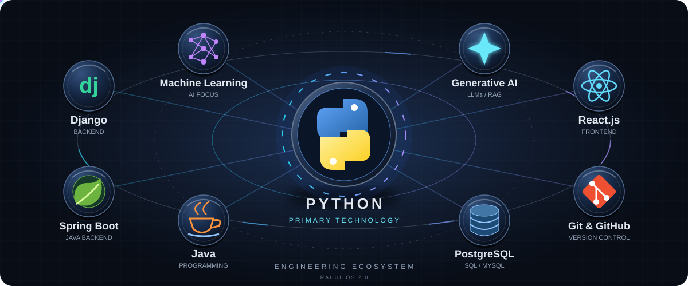

</div>

### Primary Stack — Python & AI

<p align="left">
  
</p>

**Focus:** Python, Django, Artificial Intelligence, intelligent applications and backend engineering.

### Backend Development

<p align="left">
  
</p>

**Technologies:** Java, Spring Boot, Django, REST APIs, authentication and server-side development.

### Frontend Development

<p align="left">
  
</p>

**Technologies:** React.js, JavaScript, HTML5, CSS3 and Bootstrap.

### Databases

<p align="left">
  
</p>

**Focus:** PostgreSQL, MySQL, SQL queries and relational database design.

### Development Tools

<p align="left">
  
</p>

**Tools:** VS Code, IntelliJ IDEA, Git, GitHub, Postman and npm.

---

<!-- ====================================================== -->
<!--                   PROJECT MULTIVERSE                   -->
<!-- ====================================================== -->

## 05 — Project Multiverse

> Turning ideas into practical, intelligent and user-focused applications.

<table width="100%">
  <tr>
    <td width="50%" valign="top">
      <div align="center">
        
        <h3>HireSmart</h3>
        <strong>AI-Powered Recruitment Platform</strong>
      </div>
      <br/>
      An intelligent recruitment platform connecting candidates and recruiters through AI-powered hiring tools.
      <br/><br/>
      <strong>Key Features</strong>
      <ul>
        <li>AI resume analysis</li>
        <li>Skill gap identification</li>
        <li>Job recommendations</li>
        <li>AI candidate matching</li>
        <li>Candidate and recruiter dashboards</li>
      </ul>
      <strong>Technology Stack</strong>
      <br/><br/>
      
      <br/><br/>
      <a href="https://github.com/rahulbhadekar?tab=repositories&q=HireSmart">
        
      </a>
    </td>
    <td width="50%" valign="top">
      <div align="center">
        
        <h3>ClickStore</h3>
        <strong>Full Stack E-Commerce Platform</strong>
      </div>
      <br/>
      A full stack e-commerce application focused on product management, backend integration and digital shopping experiences.
      <br/><br/>
      <strong>Project Highlights</strong>
      <ul>
        <li>Product catalog management</li>
        <li>Spring Boot backend</li>
        <li>PostgreSQL integration</li>
        <li>Bulk import of 120 demo products</li>
        <li>Automated product image upload</li>
      </ul>
      <strong>Technology Stack</strong>
      <br/><br/>
      
      <br/><br/>
      <a href="https://github.com/rahulbhadekar?tab=repositories&q=ClickStore">
        
      </a>
    </td>
  </tr>
  <tr>
    <td width="50%" valign="top">
      <div align="center">
        
        <h3>GoTrip</h3>
        <strong>Full Stack Travel Platform</strong>
      </div>
      <br/>
      A travel-focused web application designed around a convenient and engaging digital travel experience.
      <br/><br/>
      <strong>Project Focus</strong>
      <ul>
        <li>Travel-oriented user experience</li>
        <li>Destination exploration</li>
        <li>Full stack web development</li>
        <li>User-focused interface design</li>
      </ul>
      <br/>
      <a href="https://github.com/rahulbhadekar?tab=repositories&q=GoTrip">
        
      </a>
    </td>
    <td width="50%" valign="top">
      <div align="center">
        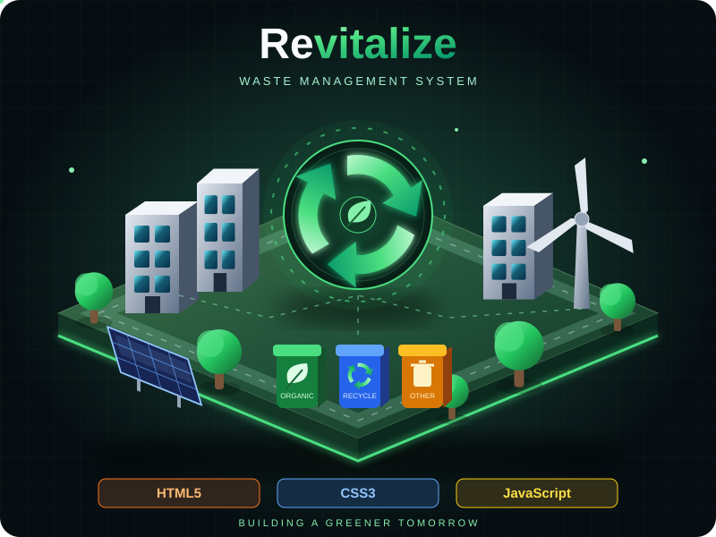
        <h3>Revitalize</h3>
        <strong>Waste Management System</strong>
      </div>
      <br/>
      A frontend web project promoting environmental awareness, responsible waste management and sustainable practices.
      <br/><br/>
      <strong>Project Focus</strong>
      <ul>
        <li>Waste management awareness</li>
        <li>Environmental sustainability</li>
        <li>Frontend web development</li>
        <li>User-friendly interface</li>
      </ul>
      <strong>Technology Stack</strong>
      <br/><br/>
      
      <br/><br/>
      <a href="https://github.com/rahulbhadekar?tab=repositories&q=Revitalize">
        
      </a>
    </td>
  </tr>
</table>

<div align="center">

  <a href="https://github.com/rahulbhadekar?tab=repositories">
    
  </a>

</div>

---

<!-- ====================================================== -->
<!--                 ENGINEERING DIRECTION                  -->
<!-- ====================================================== -->

## 06 — Engineering Direction

My engineering direction combines artificial intelligence with practical software development, focusing on intelligent systems that solve meaningful problems.

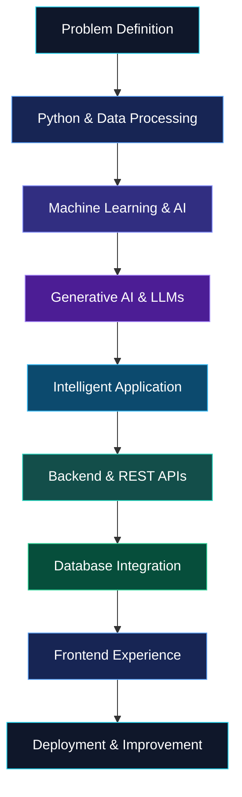

| AI Engineering Direction | Software Engineering Direction |
|:---|:---|
| Python Engineering | Backend Architecture |
| Data Science | REST API Development |
| Machine Learning | Authentication & Authorization |
| Deep Learning | Database Design |
| Generative AI | Full Stack Applications |
| Large Language Models | Software Deployment |
| AI Agents & RAG | System Design |

---

<!-- ====================================================== -->
<!--                  PORTFOLIO EXPERIENCE                  -->
<!-- ====================================================== -->

## 07 — Portfolio Experience

<div align="center">

  <a href="https://rahul-bhadekar-portfolio.netlify.app">
    
  </a>

</div>

My portfolio brings together my projects, technical interests, development experience and professional journey.

<div align="center">

  <a href="https://rahul-bhadekar-portfolio.netlify.app">
    
  </a>

</div>

---

<!-- ====================================================== -->
<!--                   DEVELOPER TELEMETRY                  -->
<!-- ====================================================== -->

## 08 — Developer Telemetry

<div align="center">

  

  <br/><br/>

  

  

  <br/><br/>

  

</div>

### Contribution Activity

<div align="center">

  

</div>

---

<!-- ====================================================== -->
<!--                  CONTRIBUTION UNIVERSE                 -->
<!-- ====================================================== -->

## 09 — Contribution Universe

### 🧊 3D Contribution Landscape

<div align="center">

  

</div>

### 🐍 Contribution Snake

<div align="center">

  <picture>
    <source media="(prefers-color-scheme: dark)" srcset="https://raw.githubusercontent.com/rahulbhadekar/rahulbhadekar/output/github-contribution-grid-snake-dark.svg"/>
    <source media="(prefers-color-scheme: light)" srcset="https://raw.githubusercontent.com/rahulbhadekar/rahulbhadekar/output/github-contribution-grid-snake.svg"/>
    
  </picture>

</div>

### 👾 Pac-Man Contribution Graph

<div align="center">

  <picture>
    <source media="(prefers-color-scheme: dark)" srcset="https://raw.githubusercontent.com/rahulbhadekar/rahulbhadekar/output/pacman-contribution-graph-dark.svg"/>
    <source media="(prefers-color-scheme: light)" srcset="https://raw.githubusercontent.com/rahulbhadekar/rahulbhadekar/output/pacman-contribution-graph.svg"/>
    
  </picture>

</div>

---

<!-- ====================================================== -->
<!--                 RAHULTECHNOTES STUDIO                  -->
<!-- ====================================================== -->

## 10 — RahulTechNotes


### Learn. Code. Grow.

**RahulTechNotes** is my technical knowledge-sharing initiative focused on making programming and software engineering concepts easier to understand.

I share educational content covering:

- Python programming
- Java and object-oriented programming
- SQL and database concepts
- Artificial Intelligence
- Full stack development
- Technical interview preparation
- Programming cheat sheets and revision notes

My goal is to make technical knowledge accessible, practical and valuable for developers.

<a href="https://linkedin.com/in/rahul-bhadekar">
  
</a>

<br clear="all"/>

---

<!-- ====================================================== -->
<!--                     LET'S CONNECT                      -->
<!-- ====================================================== -->

## 11 — Let's Connect

<div align="center">

  <h3>Let's build something meaningful together.</h3>

  Open to professional opportunities, technical collaborations,
  AI-powered projects and full stack development.

  <br/><br/>

  <a href="https://linkedin.com/in/rahul-bhadekar">
    
  </a>

  <a href="https://github.com/rahulbhadekar">
    
  </a>

  <a href="https://rahul-bhadekar-portfolio.netlify.app">
    
  </a>

  <a href="mailto:rahulbhadekar2@gmail.com">
    
  </a>

  <br/><br/>

  **Email:** rahulbhadekar2@gmail.com

</div>

---

<!-- ====================================================== -->
<!--                  CINEMATIC SIGNATURE                   -->
<!-- ====================================================== -->

<div align="center">

  

  <br/>

  <sub>Designed with purpose. Built with passion. Powered by curiosity.</sub>

  <br/>

  <sub>RAHUL OS 2.0 — AI Engineer Edition</sub>

  <br/>

  <sub>© 2026 Rahul Bhadekar | RahulTechNotes</sub>

</div>
