<!--
    RAHUL OS — AI ENGINEERING PORTFOLIO
    Design: Engineering Editorial Edition
    Author: Rahul Bhadekar
-->

<!-- ==================== INTRODUCTION ==================== -->

<div align="center">


<h1>Hey, I'm Rahul Bhadekar 👋</h1>

<h3>Python Developer · AI Engineering · Full Stack Developer</h3>


<p>
<i>Bringing together software engineering and artificial intelligence to build meaningful applications.</i>
</p>

<a href="https://rahul-bhadekar-portfolio.netlify.app">

</a>
<a href="https://www.linkedin.com/in/rahul-bhadekar">

</a>
<a href="mailto:rahulbhadekar2@gmail.com">

</a>

<br/><br/>


<br/><br/>

<a href="#about-me">About</a> •
<a href="#selected-work">Projects</a> •
<a href="#technical-toolkit">Skills</a> •
<a href="#ai-engineering">AI Engineering</a> •
<a href="#github-activity">Activity</a> •
<a href="#connect">Contact</a>

</div>

---

<!-- ==================== ABOUT ME ==================== -->

<a name="about-me"></a>

## 01 — About Me



I'm Rahul, a Computer Science Engineering developer from India with a strong interest in **Python, Artificial Intelligence, and Software Engineering**.

I enjoy understanding how things work, solving technical problems, and turning ideas into applications that people can actually use.

My work brings together backend development, intelligent application features, database design, and modern frontend technologies.

**What defines my engineering interests:**

- Building AI-powered applications with Python.
- Designing backend services and REST APIs.
- Developing complete full stack applications.
- Solving problems through structured programming.
- Sharing technical knowledge through RahulTechNotes.

<br clear="both"/>

### A quick introduction in Python

```python
developer = {
    "name": "Rahul Bhadekar",
    "location": "India",
    "primary_focus": ["Python", "Artificial Intelligence"],
    "development": ["Django", "Java", "Spring Boot", "React"],
    "interests": ["GenAI", "LLMs", "AI Agents", "System Design"],
    "passion": "Building software that solves real problems"
}
```

<p align="center">

</p>

---

<!-- ==================== FLAGSHIP PROJECT ==================== -->

<a name="selected-work"></a>

## 02 — Selected Engineering Work

Projects where I bring together programming, application architecture, intelligent features, and practical problem solving.

### 01 / HireSmart

**AI-Powered Recruitment & Career Intelligence Platform**

<p align="center">
<a href="https://github.com/rahulbhadekar/HireSmart">

</a>
</p>

HireSmart connects candidates and recruiters through intelligent recruitment workflows. The platform helps candidates understand how their skills align with job opportunities and supports recruiters with explainable candidate evaluation.

<p align="center">


</p>

#### Engineering Highlights

| Capability | Implementation |
| :--- | :--- |
| Resume Intelligence | PDF processing and technical skill extraction |
| Candidate Matching | Weighted skill and experience evaluation |
| Explainability | Matched skills, missing skills and score breakdown |
| Recommendations | Skill-based job relevance scoring |
| Security | JWT authentication and role-based permissions |
| Architecture | Modular Django backend and React frontend |
| Storage | PostgreSQL and Supabase Storage |

#### How the intelligence engine works

```text
                 Resume Upload
                       |
               PDF Text Extraction
                       |
             Technical Skill Extraction
                       |
                Skill Normalization
                       |
                Job Requirement Analysis
                       |
                Weighted Matching Engine
                       |
          +------------+-------------+
          |            |             |
      Match Score   Skill Gaps   Recommendations
```

**Built with**


`Django REST Framework` `PyMuPDF` `NumPy` `JWT` `Supabase`

<p>
<a href="https://github.com/rahulbhadekar/HireSmart">

</a>
</p>

---

<!-- ==================== CLICKSTORE ==================== -->

### 02 / ClickStore


**Full Stack E-Commerce Platform**

An e-commerce application built around modular backend services and a responsive shopping interface.

- Product and category management
- Shopping cart and checkout workflows
- Order management
- User authentication and security
- Cloud-based product image storage
- Automated bulk product import

**Stack:** Java, Spring Boot, React, Spring Security, JPA and SQL.

<a href="https://github.com/rahulbhadekar/ClickStore-Backend">Backend Repository</a> ·
<a href="https://github.com/rahulbhadekar/ClickStore-Frontend">Frontend Repository</a>

<br clear="both"/>

---

<!-- ==================== GOTRIP ==================== -->

### 03 / GoTrip


**Full Stack Travel Booking Application**

A travel-focused web application combining frontend interfaces with backend services and relational database management.

**Engineering areas:**

- Full stack application development
- Backend and frontend integration
- Database-driven workflows
- Responsive web design


[Explore GoTrip Source Code](https://github.com/rahulbhadekar/Go-Trip-Full-Stack)

<br clear="both"/>

---

<!-- ==================== REVITALIZE ==================== -->

### 04 / Revitalize


**Waste Management Website**

A frontend project designed to encourage environmental awareness and responsible waste management.

This project reflects my interest in using web development to address meaningful social and environmental challenges.

**Built with:** HTML5, CSS3 and JavaScript.


<br clear="both"/>

<p align="center">

<a href="https://github.com/rahulbhadekar?tab=repositories">

</a>

</p>

---

<!-- ==================== TECHNICAL TOOLKIT ==================== -->

<a name="technical-toolkit"></a>

## 03 — Technical Toolkit

The technologies, frameworks, and engineering concepts behind my projects.

### Languages


`Python` · `Java` · `JavaScript` · `SQL` · `HTML5` · `CSS3`

### Backend & API Engineering


`Django` · `Django REST Framework` · `Spring Boot`

`Spring Data JPA` · `Hibernate` · `REST APIs` · `ORM`

### Frontend Engineering


`React.js` · `Tailwind CSS` · `React Router`

`Axios` · `Responsive Design` · `Component Architecture`

### Databases & Cloud Storage


`PostgreSQL` · `MySQL` · `Supabase Storage`

`SQL Queries` · `Database Relationships` · `Normalization`

### Application Security

<p>


</p>

`Authentication` · `Authorization` · `Password Hashing`

`Protected APIs` · `Role-Based Access` · `Input Validation`

### Developer Tools


`Git` · `GitHub` · `VS Code` · `IntelliJ IDEA`

`PyCharm` · `Postman` · `pgAdmin` · `Maven`

---

<!-- ==================== APPLIED AI ==================== -->

<a name="ai-engineering"></a>

## 04 — Artificial Intelligence & Intelligent Systems

<p align="center">

</p>

My primary engineering direction is Artificial Intelligence and Python development, with a particular interest in connecting intelligent techniques to real-world software systems.

### Applied AI Experience

| Area | Practical Application |
| :--- | :--- |
| Text Processing | Resume text extraction and preprocessing |
| Skill Recognition | Dictionary-based technical skill extraction |
| Intelligent Matching | Skill and experience-based weighted scoring |
| Recommendations | Job relevance and skill-gap analysis |
| Explainable Systems | Transparent matching breakdowns |
| AI Integration | Connecting intelligent services with web applications |

### AI Engineering Focus Areas

<table>
<tr>
<td width="50%" valign="top">

<h3>Machine Learning</h3>

Classification, regression, clustering, feature engineering and model evaluation.

<h3>Deep Learning</h3>

Neural networks, CNNs, transformers and representation learning.

<h3>Natural Language Processing</h3>

Text classification, semantic search and language processing.

</td>
<td width="50%" valign="top">

<h3>Generative AI</h3>

AI assistants, prompt engineering and intelligent applications.

<h3>LLMs & RAG</h3>

Embeddings, retrieval pipelines, vector search and context management.

<h3>AI Agents</h3>

Tool integration, intelligent workflows and automation.

</td>
</tr>
</table>

### AI & Data Ecosystem — Areas of Interest

<p align="center">

</p>

<p align="center">


</p>

---

<!-- ==================== ENGINEERING THINKING ==================== -->

## 05 — How I Approach Engineering


My engineering interests extend beyond writing code. I value maintainable architecture, clear documentation, meaningful testing, reliable APIs, and software that can evolve over time.

<details>
<summary><b>Explore my technical development roadmap</b></summary>

<br/>

| AI Engineering Direction | Software Engineering Direction |
| :--- | :--- |
| Python Programming | Programming & OOP |
| Mathematics & Statistics | Data Structures & Algorithms |
| Data Science | Python & Java Backend |
| Machine Learning | REST APIs & Databases |
| Deep Learning | Application Security |
| NLP & Transformers | Full Stack Architecture |
| Generative AI & LLMs | Microservices |
| RAG & AI Agents | Docker & CI/CD |
| Model Deployment & MLOps | Cloud & System Design |

<p align="center">

</p>

</details>

---

<!-- ==================== PORTFOLIO ==================== -->

## 06 — My Digital Portfolio

<p align="center">
<a href="https://rahul-bhadekar-portfolio.netlify.app">

</a>
</p>

<p align="center">
Explore my projects, engineering interests and professional journey in one place.
</p>

<p align="center">
<a href="https://rahul-bhadekar-portfolio.netlify.app">

</a>
</p>

---

<!-- ==================== GITHUB ACTIVITY ==================== -->

<a name="github-activity"></a>

## 07 — Code, Consistency & Contributions

<p align="center">


</p>

<p align="center">

</p>

### Contribution Activity


### 3D Contribution Landscape

<p align="center">

</p>

<details>
<summary><b>View animated contribution visualizations</b></summary>

<br/>

<h3 align="center">Contribution Snake</h3>


<h3 align="center">Pacman Contribution Graph</h3>


</details>

---

<!-- ==================== KNOWLEDGE SHARING ==================== -->

## 08 — Beyond Writing Code



### RahulTechNotes

**LEARN • CODE • GROW**

I believe understanding a concept and explaining it clearly are equally important.

Through RahulTechNotes, I share technical notes, programming concepts, interview preparation resources, and practical development knowledge.

**Content areas:**

- Python & Java programming
- Artificial Intelligence
- SQL & databases
- Full stack development
- Technical interview preparation
- Programming cheat sheets

<a href="https://www.linkedin.com/in/rahul-bhadekar">

</a>

<br clear="both"/>

---

<!-- ==================== CONTACT ==================== -->

<a name="connect"></a>

## 09 — Let's Connect

I'm interested in professional opportunities, AI-powered projects, software engineering roles, and meaningful technical collaborations.

If you're working on something interesting, feel free to connect.

<div align="center">

<a href="https://rahul-bhadekar-portfolio.netlify.app">

</a>
<a href="https://www.linkedin.com/in/rahul-bhadekar">

</a>
<a href="https://github.com/rahulbhadekar">

</a>
<a href="mailto:rahulbhadekar2@gmail.com">

</a>

<br/><br/>

**rahulbhadekar2@gmail.com**

</div>

---

<!-- ==================== SIGNATURE ==================== -->

<div align="center">


<h3>Build with purpose. Engineer with curiosity.</h3>

Thanks for visiting my GitHub profile.

**Keep Learning. Keep Coding. Keep Growing.**

<sub>RAHUL OS — AI ENGINEERING EDITION</sub>

<br/>

<sub>#RahulTechNotes</sub>

</div>
