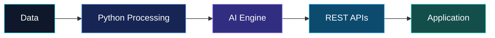
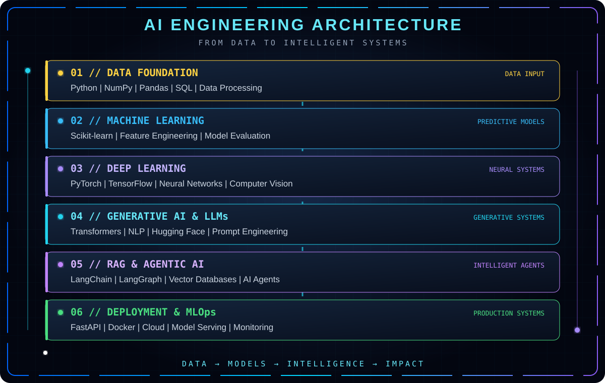

<!-- ====================================================== -->
<!--         RAHUL OS 2.0 — AI ENGINEER EDITION             -->
<!-- ====================================================== -->

<div align="center">


<h1>Hey there, I'm Rahul Bhadekar 👋</h1>

<h3>AI Engineer | Python Developer | Full Stack Developer</h3>


<p>
<i>Turning ideas into intelligent applications through code, creativity and engineering.</i>
</p>

<a href="https://rahul-bhadekar-portfolio.netlify.app">

</a>
<a href="https://www.linkedin.com/in/rahul-bhadekar">

</a>
<a href="https://github.com/rahulbhadekar">

</a>
<a href="mailto:rahulbhadekar2@gmail.com">

</a>

<br/><br/>


<br/><br/>

[About Me](#about-me) •
[Tech Stack](#tech-stack) •
[AI Engineering](#ai-engineering) •
[Projects](#projects) •
[GitHub Activity](#github-activity) •
[Contact](#contact)

</div>


<!-- ==================== ABOUT ME ==================== -->

<a name="about-me"></a>

## ◈ 01 // About Me


### Building software. Engineering intelligence.

I'm a Computer Science Engineering graduate with a strong interest in **Artificial Intelligence, Python Development and Full Stack Engineering**.

I enjoy solving real-world problems by combining intelligent application features, reliable backend architecture and meaningful user experiences.

- 🐍 Python & Backend Development
- 🤖 Artificial Intelligence & Generative AI
- 🧠 Machine Learning & Intelligent Systems
- ⚙️ Django, Java & Spring Boot
- ⚛️ React.js & Full Stack Development
- 🗄️ SQL & Database Management
- 💻 Data Structures & Problem Solving
- 📚 Technical Knowledge Sharing

**My mission:** Build technology that is intelligent, reliable and useful.

<br clear="both"/>

### A little more about me

```python
class Developer:

    def __init__(self):
        self.name = "Rahul Bhadekar"
        self.location = "India"
        self.education = "Computer Science Engineering"

        self.primary_focus = [
            "Python",
            "Artificial Intelligence",
            "Backend Engineering"
        ]

        self.development_stack = [
            "Django", "Java", "Spring Boot",
            "React.js", "PostgreSQL", "MySQL"
        ]

        self.interests = [
            "Machine Learning",
            "Generative AI",
            "LLMs", "AI Agents",
            "System Design"
        ]

        self.brand = "RahulTechNotes"

    def philosophy(self):
        return "Learn. Build. Share. Repeat."
```

<div align="center">


</div>


<!-- ==================== WHAT I DO ==================== -->

## ◈ 02 // What I Do

<table>
<tr>
<td width="50%" valign="top">

<h3>🤖 Artificial Intelligence</h3>

Artificial intelligence and intelligent application development are my primary engineering interests.

<ul>
<li>Intelligent recommendation systems</li>
<li>Resume text and skill extraction</li>
<li>Candidate matching systems</li>
<li>Machine Learning concepts</li>
<li>Generative AI and LLMs</li>
</ul>

</td>
<td width="50%" valign="top">

<h3>🐍 Python Development</h3>

Building backend applications and software solutions using Python.

<ul>
<li>Python programming</li>
<li>Django and REST APIs</li>
<li>Object-oriented programming</li>
<li>Database integration</li>
<li>Automation and scripting</li>
</ul>

</td>
</tr>

<tr>
<td width="50%" valign="top">

<h3>🌐 Full Stack Development</h3>

Developing end-to-end applications with connected frontend and backend systems.

<ul>
<li>React.js applications</li>
<li>Responsive web development</li>
<li>REST API integration</li>
<li>Authentication and authorization</li>
<li>Database-driven applications</li>
</ul>

</td>
<td width="50%" valign="top">

<h3>☕ Java & Backend Engineering</h3>

Developing structured backend applications using the Java ecosystem.

<ul>
<li>Core Java and OOP</li>
<li>Spring Boot applications</li>
<li>Spring Data JPA and Hibernate</li>
<li>RESTful web services</li>
<li>Data Structures and Algorithms</li>
</ul>

</td>
</tr>
</table>


<!-- ==================== TECH STACK ==================== -->

<a name="tech-stack"></a>

## ◈ 03 // Technology Universe

### 🐍 Programming Languages


`Python` • `Java` • `JavaScript` • `SQL` • `HTML5` • `CSS3`

### ⚙️ Backend & Frameworks


`Django` • `Django REST Framework` • `Spring Boot`

`Spring Data JPA` • `Hibernate` • `REST APIs`

`ORM` • `MVC Architecture` • `CRUD Operations`

### ⚛️ Frontend Development


`React.js` • `JavaScript` • `HTML5` • `CSS3`

`React Hooks` • `Responsive Design` • `API Integration`

`Tailwind CSS` • `Bootstrap` • `Component Architecture`

### 🗄️ Databases & Storage


`PostgreSQL` • `MySQL` • `SQL` • `Supabase Storage`

`Joins` • `Subqueries` • `Database Relationships`

`Normalization` • `Database Design`

### 🔐 Application Security

<p>


</p>

`Authentication` • `Authorization` • `JWT`

`Role-Based Access Control` • `Password Hashing`

`Protected APIs` • `Input Validation`

### 🐳 Cloud & DevOps — Engineering Interests


`Docker` • `AWS` • `Linux` • `CI/CD`

`Cloud Deployment` • `GitHub Actions`

### 🔧 Development Tools


`Git` • `GitHub` • `VS Code` • `IntelliJ IDEA`

`PyCharm` • `Postman` • `pgAdmin` • `Maven`


<!-- ==================== AI ENGINEERING ==================== -->

<a name="ai-engineering"></a>

## ◈ 04 // Artificial Intelligence Universe

<p align="center">

</p>

Artificial Intelligence is the central direction of my engineering journey. My interest lies in connecting intelligent techniques with practical applications, data processing and modern software architecture.

### 🧠 AI Engineering Focus Areas

| Domain | Technical Focus |
| :--- | :--- |
| Python Engineering | Automation, application development and data processing |
| Machine Learning | Regression, classification, clustering and model evaluation |
| Deep Learning | Neural networks, CNNs and transformers |
| Generative AI | AI assistants, prompt engineering and intelligent applications |
| Natural Language Processing | Text processing, classification and semantic search |
| Large Language Models | LLM integration, embeddings and context management |
| RAG | Retrieval-augmented generation and vector search |
| AI Agents | Tool integration, intelligent workflows and automation |
| Data Science | Data analysis, preprocessing and visualization |
| MLOps | Model deployment, monitoring and AI infrastructure |

### AI & Data Science Ecosystem — Areas of Interest

<div align="center">


<br/><br/>


<br/>


</div>

### From Data to Intelligent Applications




<!-- ==================== PROJECTS ==================== -->

<a name="projects"></a>

## ◈ 05 // Project Multiverse

A collection of applications built around artificial intelligence, backend engineering, full stack development and real-world problem solving.

<!-- ==================== HIRESMART ==================== -->

<h2 align="center">01 — HireSmart</h2>

<h4 align="center">AI-Powered Recruitment & Career Intelligence Platform</h4>

<div align="center">

<a href="https://github.com/rahulbhadekar/HireSmart">

</a>

<br/><br/>


</div>

HireSmart is an intelligent recruitment platform designed to bridge the gap between candidates and recruiters through resume intelligence, skill analysis and personalized recommendations.

<table>
<tr>
<td width="50%" valign="top">

<h3>👨‍💻 Candidate Features</h3>

<ul>
<li>Candidate registration and login</li>
<li>Candidate dashboard</li>
<li>Resume upload</li>
<li>AI resume analysis</li>
<li>Skill gap analysis</li>
<li>Personalized job recommendations</li>
<li>Job search and applications</li>
<li>Saved jobs</li>
</ul>

</td>
<td width="50%" valign="top">

<h3>🏢 Recruiter Features</h3>

<ul>
<li>Recruiter registration and login</li>
<li>Recruiter dashboard</li>
<li>Recruiter profile management</li>
<li>Job management</li>
<li>AI candidate matching</li>
<li>Candidate evaluation</li>
<li>Recruitment workflows</li>
<li>Role-based access</li>
</ul>

</td>
</tr>
</table>

### How the intelligence engine works

```text
                  Resume Upload
                        │
                        ▼
                PDF Text Extraction
                        │
                        ▼
                Skill Identification
                        │
                        ▼
               Job Requirement Analysis
                        │
                        ▼
                Weighted Matching Engine
                        │
          ┌─────────────┼─────────────┐
          ▼             ▼             ▼
      Match Score    Skill Gaps    Job Recommendations
```

<div align="center">

<h4>Technology Stack</h4>


<br/><br/>

<a href="https://github.com/rahulbhadekar/HireSmart">

</a>
<a href="https://hiresmart-careers.netlify.app">

</a>

</div>

---

<!-- ==================== CLICKSTORE ==================== -->

### 02 — ClickStore

<table>
<tr>
<td width="45%" valign="middle">



</td>
<td width="55%" valign="top">

<h3>🛒 Full Stack E-Commerce Platform</h3>

A database-driven e-commerce application focused on product management, reliable backend services and automated workflows.

<b>Key Features</b>

<ul>
<li>Product catalog and management</li>
<li>REST API integration</li>
<li>Database-driven workflows</li>
<li>Authentication and security</li>
<li>Bulk product import</li>
<li>Automated product image uploads</li>
</ul>


<br/><br/>

<a href="https://github.com/rahulbhadekar/ClickStore-Backend">

</a>
<a href="https://github.com/rahulbhadekar/ClickStore-Frontend">

</a>

</td>
</tr>
</table>

---

<!-- ==================== GOTRIP ==================== -->

### 03 — GoTrip

<table>
<tr>
<td width="55%" valign="top">

<h3>✈️ Full Stack Travel Application</h3>

A travel-focused application designed to provide convenient digital travel experiences through integrated frontend and backend systems.

<b>Engineering Highlights</b>

<ul>
<li>Full stack application development</li>
<li>Frontend and backend integration</li>
<li>Database-driven workflows</li>
<li>Responsive web interfaces</li>
<li>Travel-oriented user experience</li>
</ul>


<br/><br/>

<a href="https://github.com/rahulbhadekar/Go-Trip-Full-Stack">

</a>

</td>
<td width="45%" valign="middle">


</td>
</tr>
</table>

---

<!-- ==================== REVITALIZE ==================== -->

### 04 — Revitalize

<table>
<tr>
<td width="45%" valign="middle">



</td>
<td width="55%" valign="top">

<h3>♻️ Waste Management Website</h3>

A sustainability-focused frontend project promoting waste management awareness, recycling and responsible environmental practices.

<b>Project Highlights</b>

<ul>
<li>Environmental awareness</li>
<li>Waste management information</li>
<li>Responsive web design</li>
<li>User-friendly interface</li>
<li>Sustainable development awareness</li>
</ul>


<br/><br/>

<a href="https://github.com/rahulbhadekar?tab=repositories&q=Revitalize">

</a>

</td>
</tr>
</table>

<br/>

<div align="center">

<a href="https://github.com/rahulbhadekar?tab=repositories">

</a>

</div>


<!-- ==================== ENGINEERING JOURNEY ==================== -->

## ◈ 06 // Engineering Direction

Two connected engineering paths — Artificial Intelligence and Software Development.

<table>
<tr>
<td width="50%" valign="top">

<h3 align="center">🤖 AI Engineering</h3>

<pre>
Python Programming
        │
        ▼
Mathematics & Statistics
        │
        ▼
Data Analysis
        │
        ▼
Machine Learning
        │
        ▼
Deep Learning
        │
        ▼
NLP & Transformers
        │
        ▼
Generative AI & LLMs
        │
        ▼
Embeddings & Vector Search
        │
        ▼
RAG & AI Agents
        │
        ▼
AI Application Development
        │
        ▼
Model Deployment & MLOps
</pre>

</td>
<td width="50%" valign="top">

<h3 align="center">💻 Software Engineering</h3>

<pre>
Programming Fundamentals
        │
        ▼
OOP & Collections
        │
        ▼
Data Structures & Algorithms
        │
        ▼
Python & Java
        │
        ▼
Django & Spring Boot
        │
        ▼
SQL & Database Design
        │
        ▼
REST API Development
        │
        ▼
Authentication & Security
        │
        ▼
React & Full Stack
        │
        ▼
Cloud & DevOps
        │
        ▼
Scalable System Design
</pre>

</td>
</tr>
</table>

<div align="center">

<h3>Artificial Intelligence + Software Engineering</h3>

<h2>↓</h2>

<h3>Intelligent Real-World Applications</h3>

</div>

<details>
<summary><b>Explore AI Engineering Architecture</b></summary>

<br/>

<p align="center">

</p>

</details>


<!-- ==================== PORTFOLIO ==================== -->

## ◈ 07 // Portfolio Experience

<div align="center">

<a href="https://rahul-bhadekar-portfolio.netlify.app">

</a>

<h3>More than code. Built with purpose.</h3>

<p>
Explore my projects, technical interests, professional journey and engineering capabilities through my personal portfolio.
</p>

<a href="https://rahul-bhadekar-portfolio.netlify.app">

</a>

</div>


<!-- ==================== GITHUB STATS ==================== -->

<a name="github-activity"></a>

## ◈ 08 // Developer Telemetry

<div align="center">


<br/><br/>


</div>

### 📈 Contribution Activity

<div align="center">


</div>


<!-- ==================== CONTRIBUTIONS ==================== -->

## ◈ 09 // Contribution Universe

### 🌌 3D Contribution Skyline

<p align="center">


</p>

### 🐍 Contribution Snake

<div align="center">

<picture>
<source media="(prefers-color-scheme: dark)" srcset="https://raw.githubusercontent.com/rahulbhadekar/rahulbhadekar/output/github-snake-dark.svg"/>
<source media="(prefers-color-scheme: light)" srcset="https://raw.githubusercontent.com/rahulbhadekar/rahulbhadekar/output/github-snake.svg"/>

</picture>

</div>

### 👾 Pac-Man Contribution Animation

<div align="center">

<picture>
<source media="(prefers-color-scheme: dark)" srcset="https://raw.githubusercontent.com/rahulbhadekar/rahulbhadekar/output/pacman-contribution-graph-dark.svg"/>
<source media="(prefers-color-scheme: light)" srcset="https://raw.githubusercontent.com/rahulbhadekar/rahulbhadekar/output/pacman-contribution-graph.svg"/>

</picture>

</div>


<!-- ==================== KNOWLEDGE HUB ==================== -->

## ◈ 10 // Knowledge Hub


### RahulTechNotes

**LEARN • CODE • GROW**

I believe that knowledge becomes more valuable when it is shared.

Through RahulTechNotes, I create and share technical resources that make programming and software development concepts easier to understand.

**Topics I Share**

- 🐍 Python Programming
- ☕ Java & Object-Oriented Programming
- 🤖 Artificial Intelligence & Machine Learning
- 🧠 Data Structures & Algorithms
- 🗄️ SQL & Database Management
- 🌐 Full Stack Development
- 📚 Programming Cheat Sheets
- 🎯 Technical Interview Preparation

<a href="https://www.linkedin.com/in/rahul-bhadekar">

</a>

<br clear="both"/>


<!-- ==================== CONTACT ==================== -->

<a name="contact"></a>

## ◈ 11 // Let's Connect

<div align="center">

<h2>Let's build something meaningful together.</h2>

<p>
Open to professional opportunities in Artificial Intelligence, Python Development, Backend Engineering and Full Stack Development.
</p>

<br/>

<a href="https://www.linkedin.com/in/rahul-bhadekar">

</a>
<a href="https://rahul-bhadekar-portfolio.netlify.app">

</a>
<a href="https://github.com/rahulbhadekar">

</a>
<a href="mailto:rahulbhadekar2@gmail.com">

</a>

<br/><br/>

📧 <b>rahulbhadekar2@gmail.com</b>

</div>

<!-- ==================== FOOTER ==================== -->

<div align="center">


<h3>Thanks for visiting my profile! ❤️</h3>

<i>Keep learning. Keep building. Keep growing.</i>

<br/><br/>

<b>RAHUL OS 2.0 — AI ENGINEER EDITION</b>

<br/>

<sub>Designed with purpose. Built with passion.</sub>

<br/><br/>

<b>#RahulTechNotes</b>

</div>

<!-- ==================== END ==================== -->
