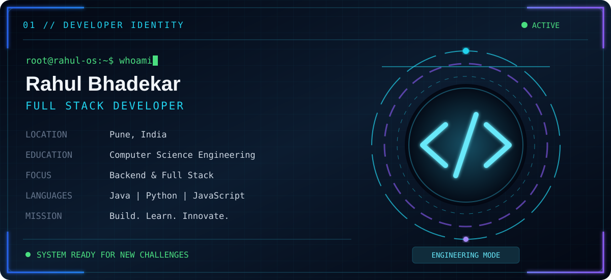
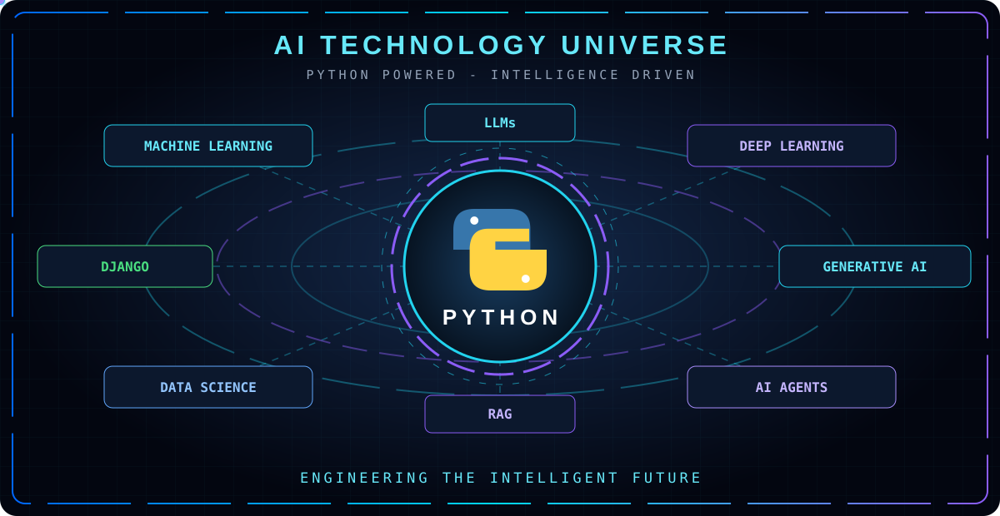
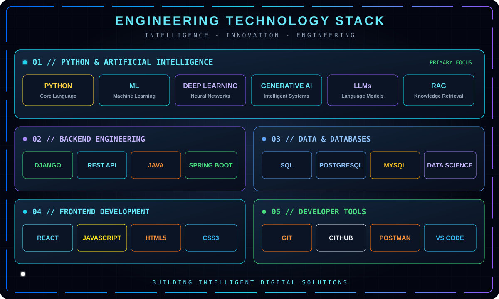
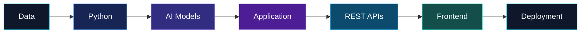

<!-- ====================================================== -->
<!--          RAHUL OS 2.0 — AI Engineer Edition            -->
<!-- ====================================================== -->
    <h1>Hi, I'm Rahul Bhadekar 👋</h1>
  <h3>Python Developer | AI Engineering | Full Stack Development</h3>
  
Building intelligent applications and reliable software systems.
    

  
  
  
    

    

<!-- ====================================================== -->
<!--                  DEVELOPER IDENTITY                    -->
<!-- ====================================================== -->◈ 01 // DEVELOPER IDENTITY
AI Engineer | Python & Full Stack Developer
I am a Computer Science Engineering graduate with a strong interest in Artificial Intelligence, Python development, intelligent applications, and scalable full stack systems.

My focus is on building practical software that combines intelligent automation, reliable backend architecture, and meaningful user experiences.
- Primary Focus: Python, Artificial Intelligence and Generative AI.
- AI Engineering Interests: Machine Learning, Deep Learning, LLMs and Intelligent Systems.
- Development: Django, Java, Spring Boot, React and REST APIs.
- Databases: PostgreSQL, MySQL and relational database systems.
- Knowledge Sharing: Technical notes, programming concepts and interview preparation through RahulTechNotes.
 

  

<!-- ====================================================== -->
<!--                   AI UNIVERSE                          -->
<!-- ====================================================== -->◈ 02 // ARTIFICIAL INTELLIGENCE UNIVERSE

    

  
  
  
  
  
  
Applied AI in My Projects
In HireSmart, I implemented resume analysis, skill-gap identification, job recommendations and candidate matching as part of an AI-powered recruitment workflow.
AI Engineering Focus Areas
Domain	Focus
Python Engineering	Automation, application development and data processing
Machine Learning	Predictive systems and intelligent decision-making
Deep Learning	Neural networks and advanced AI architectures
Generative AI	Intelligent content generation and AI applications
Large Language Models	Language understanding and AI-powered assistants
AI Integration	Connecting intelligent capabilities with real-world applications
AI Deployment	Reliable APIs and scalable AI-enabled software

  

<!-- ====================================================== -->
<!--                  TECHNOLOGY UNIVERSE                   -->
<!-- ====================================================== -->◈ 03 // TECHNOLOGY UNIVERSE

  
Primary Technology — Python & AI

    
Python · Django · PostgreSQL · Git

Backend Development

    
Java · Spring Boot · Django · REST APIs · SQL

Frontend Development

    
React.js · JavaScript · HTML5 · CSS3 · Bootstrap

Development Tools

    
VS Code · IntelliJ IDEA · Git · GitHub · Postman · npm

  

<!-- ====================================================== -->
<!--              AI ENGINEERING ARCHITECTURE               -->
<!-- ====================================================== -->◈ 04 // AI ENGINEERING ARCHITECTURE

  
A conceptual workflow for connecting intelligent models with software applications.

  

<!-- ====================================================== -->
<!--                   PROJECT MULTIVERSE                   -->
<!-- ====================================================== -->◈ 05 // PROJECT MULTIVERSE
01 — HireSmart | AI-Powered Recruitment Platform

    

    
Technology: Python, Django, React, PostgreSQL

An AI-powered recruitment platform connecting candidates and recruiters through intelligent resume analysis, skill-gap identification, job recommendations and candidate matching.
Candidate experience	Recruiter experience
Resume upload and analysis	Candidate matching
Skill-gap identification	Recruiter dashboard
Job recommendations and applications	Recruitment workflows

02 — ClickStore | Full Stack E-Commerce Platform
A full stack e-commerce application featuring product management, backend services, database integration, bulk product imports and automated image uploads.

Technology: Java, Spring Boot, SQL

Backend Repository · Frontend Repository
 03 — GoTrip | Full Stack Travel Application
A full stack travel application designed to provide a convenient digital travel experience through integrated frontend and backend systems.

Explore Source Code
 04 — Revitalize | Waste Management System
A sustainability-focused frontend website promoting waste management awareness, recycling and responsible environmental practices.

Technology: HTML, CSS, JavaScript

Explore Project
 

  

<!-- ====================================================== -->
<!--                  PORTFOLIO EXPERIENCE                  -->
<!-- ====================================================== -->◈ 06 // PORTFOLIO EXPERIENCE

    

  

  

<!-- ====================================================== -->
<!--                  DEVELOPER TELEMETRY                   -->
<!-- ====================================================== -->◈ 07 // DEVELOPER TELEMETRY

      

  
Contribution Activity

  

  

<!-- ====================================================== -->
<!--                  CONTRIBUTION UNIVERSE                 -->
<!-- ====================================================== -->◈ 08 // CONTRIBUTION UNIVERSE
3D Contribution Skyline

  
Animated Contribution Snake

  <picture>
    <source media="(prefers-color-scheme: dark)" srcset="https://raw.githubusercontent.com/rahulbhadekar/rahulbhadekar/output/github-snake-dark.svg"/>
    <source media="(prefers-color-scheme: light)" srcset="https://raw.githubusercontent.com/rahulbhadekar/rahulbhadekar/output/github-snake.svg"/>
    
  </picture>
Pac-Man Contribution Animation

  <picture>
    <source media="(prefers-color-scheme: dark)" srcset="https://raw.githubusercontent.com/rahulbhadekar/rahulbhadekar/output/pacman-contribution-graph-dark.svg"/>
    <source media="(prefers-color-scheme: light)" srcset="https://raw.githubusercontent.com/rahulbhadekar/rahulbhadekar/output/pacman-contribution-graph.svg"/>
    
  </picture>

  

<!-- ====================================================== -->
<!--                     KNOWLEDGE HUB                      -->
<!-- ====================================================== -->◈ 09 // KNOWLEDGE HUB

RahulTechNotes — LEARN • CODE • GROW
Sharing programming concepts, technical notes, interview preparation resources and practical development knowledge.
- Python & Artificial Intelligence
- Java & Object-Oriented Programming
- Data Structures & Algorithms
- Full Stack Development
- Backend Development & Databases
- Technical Interview Preparation
 
  

  

<!-- ====================================================== -->
<!--                    CONNECT WITH ME                     -->
<!-- ====================================================== -->◈ 10 // CONNECT WITH ME

  Open to opportunities in Python Development, AI Engineering, Backend Development and Full Stack Development.
  

          

  
<!-- ====================================================== -->
<!--                     END OF README                      -->
<!-- ====================================================== -->
