<!-- ====================================================== -->
<!-- RAHUL OS 2.0 | AI ENGINEER EDITION                      -->
<!-- ====================================================== -->

<h1>👋 Hi, I'm Rahul Bhadekar</h1>

<h3>AI Engineer | Python Developer | Full Stack Developer</h3>

Building intelligent applications, scalable backend systems,
and AI-powered digital experiences.

 

  

---

# 👨‍💻 About Me

<table>
<tr>
<td width="55%" valign="top">

I am a Computer Science Engineering professional with a strong interest in **Artificial Intelligence, Python Development, and Full Stack Engineering**.

I enjoy combining software engineering with artificial intelligence to solve real-world problems and build meaningful digital products.

- 🐍 Python and AI-powered application development.
- 🧠 Machine Learning and Generative AI.
- 🤖 Large Language Models, AI Agents and RAG.
- ⚙️ Backend development using Django and Spring Boot.
- ⚛️ Full stack applications using React.js.
- 🗄️ PostgreSQL, MySQL and database design.
- 🔗 REST APIs and application integration.
- 💻 Data Structures and Problem Solving.
- 📚 Technical content through RahulTechNotes.

</td>
<td width="45%" valign="middle">

</td>
</tr>
</table>

> My goal is to build intelligent, reliable, and scalable software that creates real-world impact.

---

# 💻 What I Do

<table>
<tr>
<td width="50%" valign="top">

### 🤖 Artificial Intelligence

- AI-powered applications
- Machine Learning concepts
- Generative AI
- Intelligent recommendation systems
- AI-assisted automation
- Resume and candidate analysis

</td>
<td width="50%" valign="top">

### 🐍 Python Development

- Python programming
- Object-Oriented Programming
- Django development
- REST API development
- Database integration
- Automation and scripting

</td>
</tr>
<tr>
<td width="50%" valign="top">

### 🌐 Full Stack Development

- React.js applications
- Responsive user interfaces
- Backend architecture
- Authentication and authorization
- Database-driven applications
- Frontend and backend integration

</td>
<td width="50%" valign="top">

### ☕ Java Development

- Core Java
- Object-Oriented Programming
- Collections Framework
- Spring Boot applications
- RESTful services
- Data Structures and Algorithms

</td>
</tr>
</table>

---

# 🧠 Artificial Intelligence & Machine Learning

Artificial Intelligence is a primary focus of my engineering journey. I am interested in building applications that combine intelligent models, data processing, and modern software architecture.

## AI Engineering Focus Areas

| Domain | Areas of Interest |
| :--- | :--- |
| Machine Learning | Supervised Learning, Unsupervised Learning, Model Evaluation |
| Deep Learning | Neural Networks, CNNs, Transformers |
| Generative AI | Text Generation, AI Assistants, Prompt Engineering |
| Natural Language Processing | Text Processing, Classification, Semantic Search |
| Large Language Models | LLM Integration, Embeddings, Context Management |
| AI Agents | Intelligent Workflows, Tool Integration, Automation |
| RAG | Retrieval-Augmented Generation, Vector Search |
| Data Science | Data Cleaning, Analysis, Visualization |
| MLOps | Model Deployment, Monitoring, AI System Architecture |

---

# 🛠️ Technical Skills

## 🐍 Programming Languages

`Python` • `Java` • `JavaScript` • `SQL` • `HTML5` • `CSS3`

---

## 🤖 AI & Data Science Ecosystem

**Areas of technical focus:**

`NumPy` • `Pandas` • `Scikit-learn`

`TensorFlow` • `PyTorch` • `Matplotlib`

`Hugging Face` • `LangChain` • `LLMs`

`Prompt Engineering` • `Embeddings` • `RAG`

---

## ⚙️ Backend Development

`Python` • `Django` • `Django REST Framework`

`Java` • `Spring Boot` • `Spring Data JPA`

`REST APIs` • `MVC Architecture` • `ORM`

`CRUD Operations` • `API Integration`

---

## ⚛️ Frontend Development

`React.js` • `JavaScript` • `HTML5` • `CSS3`

`React Hooks` • `Responsive Design`

`Tailwind CSS` • `Bootstrap` • `API Integration`

---

## 🗄️ Database Management

`PostgreSQL` • `MySQL` • `SQL`

`Joins` • `Subqueries` • `CRUD Operations`

`Database Relationships` • `Normalization`

`Database Design` • `Query Optimization`

---

## 🔐 Application Security

`Authentication` • `Authorization`

`JWT` • `Role-Based Access Control`

`Password Hashing` • `Protected APIs`

---

## 🐳 Cloud, Deployment & DevOps

**Engineering focus:**

`Cloud Deployment` • `Docker` • `AWS`

`Linux` • `CI/CD` • `GitHub Actions`

`Environment Configuration` • `Application Deployment`

---

## 🔧 Development Tools

`Git` • `GitHub` • `VS Code`

`IntelliJ IDEA` • `PyCharm` • `Postman`

`Jupyter Notebook` • `pgAdmin` • `Maven`

---

# 🚀 Featured Projects

## 🤖 HireSmart — AI-Powered Recruitment Platform

HireSmart is an AI-powered recruitment platform designed to connect candidates and recruiters through intelligent recruitment workflows.

**Key Features**

- AI Resume Analysis
- AI Candidate Matching
- Skill Gap Analysis
- Personalized Job Recommendations
- Candidate and Recruiter Dashboards
- Job Search and Filtering
- Resume Upload and Job Applications
- Role-Based Authentication

**Technology Stack:** Python, Django, React.js, PostgreSQL, REST APIs.

---

## 🛒 ClickStore — Full Stack E-Commerce Platform

ClickStore is an e-commerce application focused on product management, backend services, and database-driven workflows.

**Key Features**

- Product Catalog
- Product Management
- REST API Integration
- PostgreSQL Database
- Bulk Product Import
- Automated Product Image Upload
- 120 Demo Products

**Technology Stack:** Java, Spring Boot, PostgreSQL, REST APIs.

---

## 🌍 Other Projects

<table>
<tr>
<td width="50%" valign="top">

### ✈️ GoTrip

A travel-focused full stack application designed around digital travel experiences.

**Domain:** Travel & Tourism

</td>
<td width="50%" valign="top">

### ♻️ Revitalize

A waste management website designed to promote environmental awareness and sustainable waste management.

**Tech:** HTML, CSS, JavaScript

</td>
</tr>
</table>

---

# 🌐 My Portfolio

My portfolio brings together my projects, technical interests, development experience, and professional journey.

 

---

# 🎯 My Engineering Journey

<table>
<tr>
<td width="50%" valign="top">

### 🤖 AI Engineering Path

<pre>
Python Programming
        ↓
Mathematics & Statistics
        ↓
Data Analysis & Processing
        ↓
Machine Learning
        ↓
Deep Learning
        ↓
Natural Language Processing
        ↓
Generative AI & LLMs
        ↓
Embeddings & Vector Databases
        ↓
RAG & AI Agents
        ↓
AI Application Development
        ↓
Model Deployment & MLOps
</pre>

</td>
<td width="50%" valign="top">

### 💻 Software Engineering Path

<pre>
Programming Fundamentals
        ↓
Object-Oriented Programming
        ↓
Data Structures & Algorithms
        ↓
Python & Java
        ↓
Django & Spring Boot
        ↓
SQL & Database Design
        ↓
REST API Development
        ↓
React.js & Full Stack
        ↓
Authentication & Security
        ↓
Cloud & DevOps
        ↓
Scalable System Design
</pre>

</td>
</tr>
</table>

---

# 🔬 Engineering Focus

 

 

---

# 📊 GitHub Analytics

  

---

# 📈 Contribution Activity

---

# 🌌 3D Contribution Universe

---

# 🐍 Contribution Snake

---

# 👾 Pacman Contribution Graph

---

# 📚 RahulTechNotes

### LEARN • CODE • GROW

I share technical knowledge, programming notes, interview preparation resources, and practical development concepts through RahulTechNotes.

<table>
<tr>
<td width="45%" valign="middle">

</td>
<td width="55%" valign="top">

### Topics I Share

- 🐍 Python Programming
- ☕ Core Java
- 🤖 Artificial Intelligence
- 🧠 Machine Learning
- 🗄️ SQL and Databases
- ⚛️ Full Stack Development
- 💻 Data Structures and Algorithms
- 🎯 Technical Interview Preparation
- 📖 Programming Cheat Sheets
- 🚀 Real-World Project Development

</td>
</tr>
</table>

---

# 🤝 Let's Connect

I am open to professional opportunities, technical collaborations, AI-powered projects, and meaningful conversations about software engineering.

| Platform | Connect |
| :--- | :--- |
| 🌐 Portfolio | [Visit My Portfolio](https://rahul-bhadekar-portfolio.netlify.app) |
| 💼 LinkedIn | [Rahul Bhadekar](https://www.linkedin.com/in/rahul-bhadekar) |
| 💻 GitHub | [rahulbhadekar](https://github.com/rahulbhadekar) |
| 📧 Email | [rahulbhadekar2@gmail.com](mailto:rahulbhadekar2@gmail.com) |

---

**Thanks for visiting my profile!**

⭐ Explore my repositories and connect with me.

`RAHUL OS 2.0 — AI ENGINEER EDITION`

**#RahulTechNotes**

