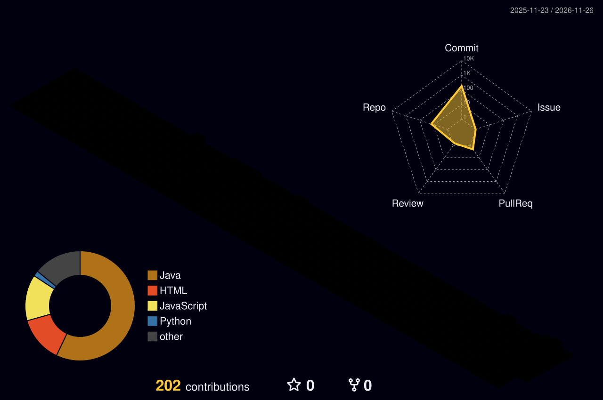

<!-- ===================================================== -->
<!-- RAHUL OS 2.0 — AI ENGINEERING PORTFOLIO                -->
<!-- ===================================================== -->

<div align="center">


<h1>Hi there, I'm Rahul Bhadekar 👋</h1>

<h3>AI Engineering • Python Development • Full Stack Engineering</h3>


<p>
  <i>Where software engineering meets artificial intelligence.</i>
</p>

<a href="https://rahul-bhadekar-portfolio.netlify.app">

</a>

<a href="https://www.linkedin.com/in/rahul-bhadekar">

</a>

<a href="mailto:rahulbhadekar2@gmail.com">

</a>

<br/><br/>


</div>

---

<!-- ==================== NAVIGATION ==================== -->

<p align="center">
  <a href="#about-me">About</a> •
  <a href="#technical-toolkit">Skills</a> •
  <a href="#artificial-intelligence">AI Engineering</a> •
  <a href="#featured-projects">Projects</a> •
  <a href="#github-activity">GitHub Activity</a> •
  <a href="#connect-with-me">Contact</a>
</p>

---

<!-- ==================== ABOUT ME ==================== -->

<h2 id="about-me">01. 👨‍💻 About Me</h2>


I'm a Computer Science Engineering professional with a passion for **Artificial Intelligence, Python, and modern software development**.

I enjoy building applications that combine intelligent features, reliable backend systems, and meaningful user experiences.

My engineering interests extend from AI-powered applications and data-driven systems to full stack development and software architecture.

- 🐍 Python & Backend Development
- 🤖 Artificial Intelligence & Generative AI
- 🧠 Machine Learning & Intelligent Systems
- 🌐 Full Stack Application Development
- ☕ Java & Spring Boot
- 🗄️ Database Design & REST APIs
- 📚 Technical Knowledge Sharing

**My philosophy:** Understand the problem, design the solution, and build something that matters.

<br clear="both"/>

---

<!-- ==================== PROFESSIONAL IDENTITY ==================== -->

## 02. Engineering Profile

```python
class RahulBhadekar:

    def __init__(self):
        self.name = "Rahul Bhadekar"
        self.location = "India"
        self.primary_focus = [
            "Artificial Intelligence",
            "Python Development",
            "Backend Engineering"
        ]

        self.secondary_focus = [
            "Java Development",
            "Full Stack Engineering"
        ]

        self.interests = [
            "Machine Learning",
            "Generative AI",
            "Large Language Models",
            "AI Agents",
            "System Design"
        ]

        self.mission = "Build intelligent software for real-world problems"

    def connect(self):
        return "Let's build something meaningful!"
```

<div align="center">


</div>

---

<!-- ==================== WHAT I DO ==================== -->

## 03. What I Do

### 🧠 Artificial Intelligence

Exploring how intelligent systems can solve practical problems through machine learning, generative AI, recommendation systems, and intelligent automation.

### 🐍 Python & Backend Engineering

Building database-driven applications, backend services, REST APIs, and application workflows using Python and Django.

### 🌐 Full Stack Development

Developing end-to-end applications by connecting responsive frontend interfaces with backend services and databases.

### ☕ Java Development

Working with Java, object-oriented programming, Spring Boot, REST APIs, and problem-solving techniques.

---

<!-- ==================== TECHNICAL SKILLS ==================== -->

<h2 id="technical-toolkit">04. 🛠️ Technical Toolkit</h2>

<table>
<tr>
<td width="28%">

**Programming Languages**

</td>
<td>


<br/>

Python • Java • JavaScript • SQL • HTML5 • CSS3

</td>
</tr>

<tr>
<td>

**Backend Development**

</td>
<td>


<br/>

Django • Spring Boot • REST APIs • ORM • MVC

</td>
</tr>

<tr>
<td>

**Frontend Development**

</td>
<td>


<br/>

React.js • Responsive Design • API Integration

</td>
</tr>

<tr>
<td>

**Databases**

</td>
<td>


<br/>

PostgreSQL • MySQL • SQL • Database Design

</td>
</tr>

<tr>
<td>

**Development Tools**

</td>
<td>


<br/>

Git • GitHub • VS Code • IntelliJ IDEA • Postman

</td>
</tr>

</table>

### AI & Data Science Ecosystem — Areas of Focus

<p align="center">


</p>

### Cloud & Software Architecture — Engineering Interests

<p align="center">


</p>

<p align="center">

Cloud Deployment • Containerization • CI/CD • Microservices • System Design

</p>

---

<!-- ==================== AI ENGINEERING ==================== -->

<h2 id="artificial-intelligence">05. 🧠 Artificial Intelligence & Intelligent Systems</h2>

<div align="center">


</div>

Artificial Intelligence represents the central direction of my engineering journey. My interest is in connecting intelligent models with practical software applications.

| Engineering Domain | Technical Focus |
| :--- | :--- |
| 🧠 Machine Learning | Regression, Classification, Clustering, Model Evaluation |
| 🔬 Deep Learning | Neural Networks, CNNs, Transformers |
| ✨ Generative AI | AI Assistants, Content Generation, Prompt Engineering |
| 💬 NLP | Text Processing, Classification, Semantic Search |
| 🤖 Large Language Models | LLM Integration, Embeddings, Context Management |
| 📚 RAG | Retrieval-Augmented Generation, Vector Search |
| ⚡ AI Agents | Intelligent Automation, Tool Integration, Agent Workflows |
| 📊 Data Science | Data Processing, Analysis, Visualization |
| ☁️ MLOps | Model Deployment, Monitoring, AI Architecture |

> The objective is not just to understand AI models, but to integrate intelligence into useful, reliable software systems.

---

<!-- ==================== PROJECTS ==================== -->

<h2 id="featured-projects">06. 🚀 Selected Projects</h2>

A collection of applications that reflect my interests in artificial intelligence, backend engineering, full stack development, and real-world problem solving.

<!-- ==================== HIRESMART ==================== -->

### 01 / HireSmart

#### AI-Powered Recruitment & Career Intelligence Platform

<div align="center">

<a href="https://github.com/rahulbhadekar?tab=repositories&q=HireSmart">

</a>

</div>

HireSmart is a recruitment platform designed to simplify the connection between candidates and recruiters through intelligent recruitment features.

<table>
<tr>
<td width="50%" valign="top">

**Candidate Experience**

- Candidate Dashboard
- Resume Upload
- AI Resume Analysis
- Skill Gap Analysis
- Job Recommendations
- Job Search & Applications

</td>
<td width="50%" valign="top">

**Recruiter Experience**

- Recruiter Dashboard
- Company Profile
- Recruitment Workflows
- AI Candidate Matching
- Candidate Management
- Role-Based Access

</td>
</tr>
</table>

**Technology Stack**


`Python` `Django` `React.js` `PostgreSQL` `REST APIs` `AI`

<a href="https://github.com/rahulbhadekar?tab=repositories&q=HireSmart">

</a>

---

<!-- ==================== CLICKSTORE ==================== -->

### 02 / ClickStore

<table>
<tr>
<td width="48%" valign="middle">

<a href="https://github.com/rahulbhadekar?tab=repositories&q=ClickStore">

</a>

</td>
<td width="52%" valign="top">

<h3>Full Stack E-Commerce Platform</h3>

A database-driven e-commerce application focused on product management and backend services.

<b>Project Highlights</b>

<ul>
<li>Product Catalog & Management</li>
<li>REST API Development</li>
<li>PostgreSQL Integration</li>
<li>Automated Bulk Product Import</li>
<li>Automated Product Image Upload</li>
<li>120 Demo Products</li>
</ul>


<br/><br/>

<a href="https://github.com/rahulbhadekar?tab=repositories&q=ClickStore">

</a>

</td>
</tr>
</table>

---

<!-- ==================== OTHER PROJECTS ==================== -->

### More Projects

<table>
<tr>
<td width="50%" valign="top">

<a href="https://github.com/rahulbhadekar?tab=repositories&q=GoTrip">

</a>

<h3>03 / GoTrip</h3>

<b>Travel & Tourism Application</b>

A full stack project focused on digital travel experiences and user-friendly travel services.

<a href="https://github.com/rahulbhadekar?tab=repositories&q=GoTrip">

</a>

</td>
<td width="50%" valign="top">

<a href="https://github.com/rahulbhadekar?tab=repositories&q=Revitalize">

</a>

<h3>04 / Revitalize</h3>

<b>Waste Management Website</b>

A frontend application promoting environmental awareness and sustainable waste management.


<br/>

<a href="https://github.com/rahulbhadekar?tab=repositories&q=Revitalize">

</a>

</td>
</tr>
</table>

<div align="center">

<a href="https://github.com/rahulbhadekar?tab=repositories">

</a>

</div>

---

<!-- ==================== ENGINEERING JOURNEY ==================== -->

## 07. 🎯 My Engineering Direction

<div align="center">


</div>

<table>
<tr>
<td width="50%" valign="top">

<h3>🤖 AI Engineering Path</h3>

<pre>
Python Programming
        │
        ▼
Mathematics & Statistics
        │
        ▼
Data Science
        │
        ▼
Machine Learning
        │
        ▼
Deep Learning
        │
        ▼
NLP & Transformers
        │
        ▼
Generative AI & LLMs
        │
        ▼
RAG & AI Agents
        │
        ▼
AI Engineering
</pre>

</td>
<td width="50%" valign="top">

<h3>💻 Software Engineering Path</h3>

<pre>
Programming Fundamentals
        │
        ▼
OOP & Data Structures
        │
        ▼
Python & Java
        │
        ▼
Django & Spring Boot
        │
        ▼
SQL & Database Design
        │
        ▼
REST API Development
        │
        ▼
React & Full Stack
        │
        ▼
Cloud & System Design
        │
        ▼
Software Engineering
</pre>

</td>
</tr>
</table>

<div align="center">

<h3>AI Engineering + Software Engineering</h3>

<b>↓</b>

<h3>Intelligent Real-World Applications</h3>

</div>

---

<!-- ==================== PORTFOLIO ==================== -->

## 08. 🌐 Beyond GitHub

My personal portfolio brings together my projects, technical interests, professional identity, and engineering journey.

<div align="center">

<a href="https://rahul-bhadekar-portfolio.netlify.app">

</a>

<br/>

<a href="https://rahul-bhadekar-portfolio.netlify.app">

</a>

</div>

---

<!-- ==================== GITHUB STATISTICS ==================== -->

<h2 id="github-activity">09. 📊 Engineering Activity</h2>

<div align="center">


<br/><br/>


</div>

### Contribution Activity

<div align="center">


</div>

### 3D Contribution Landscape

<div align="center">



</div>

<details>
<summary><b>🐍 Explore Animated Contribution Graphs</b></summary>

<br/>

<div align="center">

<h3>Contribution Snake</h3>


<h3>Pacman Contribution Graph</h3>


</div>

</details>

---

<!-- ==================== KNOWLEDGE SHARING ==================== -->

## 10. 📚 RahulTechNotes

<table>
<tr>
<td width="42%" valign="middle">


</td>
<td width="58%" valign="top">

<h2>LEARN • CODE • GROW</h2>

I believe that knowledge becomes more valuable when it is shared.

Through RahulTechNotes, I create and share programming resources, technical explanations, interview preparation notes, and practical development concepts.

<b>Content Topics</b>

<ul>
<li>Python & Java Programming</li>
<li>Artificial Intelligence & Machine Learning</li>
<li>SQL & Database Management</li>
<li>Full Stack Development</li>
<li>Technical Interview Preparation</li>
<li>Programming Cheat Sheets</li>
</ul>

<a href="https://www.linkedin.com/in/rahul-bhadekar">

</a>

</td>
</tr>
</table>

---

<!-- ==================== CONTACT ==================== -->

<h2 id="connect-with-me">11. 🤝 Let's Build Something Meaningful</h2>

<div align="center">

I am open to professional opportunities, technical collaborations, and meaningful conversations about Artificial Intelligence and Software Engineering.

<br/>

<a href="https://rahul-bhadekar-portfolio.netlify.app">

</a>

<a href="https://www.linkedin.com/in/rahul-bhadekar">

</a>

<a href="https://github.com/rahulbhadekar">

</a>

<a href="mailto:rahulbhadekar2@gmail.com">

</a>

<br/><br/>

**Email:** rahulbhadekar2@gmail.com

</div>

---

<!-- ==================== SIGNATURE ==================== -->

<div align="center">


<h3>Thanks for stopping by! ❤️</h3>

<i>Keep learning. Keep building. Keep growing.</i>

<br/><br/>

<b>RAHUL OS 2.0 — AI ENGINEER EDITION</b>

<br/>

<b>#RahulTechNotes</b>

</div>
